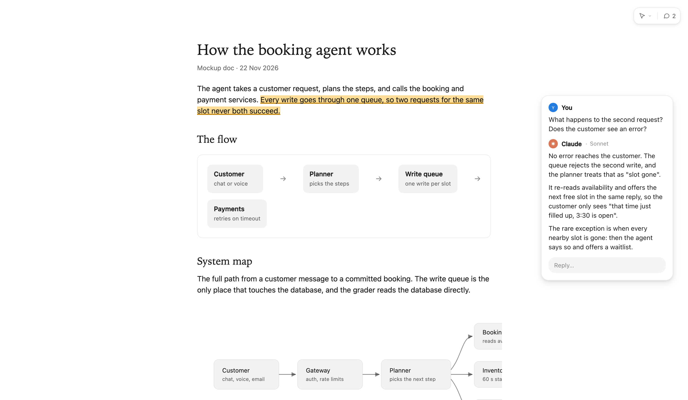

# annotatable-html

Turn any doc Claude writes you into a page you can talk back to. Select a sentence, box a diagram, or pick a block — a table, a paragraph, a node inside a Mermaid diagram — ask your question right on the spot, and the answer streams into a card beside it, kept there for next time. Answers come from Claude or Codex, whichever you pick. No API key, no server, no accounts; it runs on the [Claude Code](https://claude.com/claude-code) subscription (or Codex login) you already have.


You've hit this before: you ask Claude for a spec or an architecture write-up, get back a clean doc, and start reading — then the questions pile up. *Why base62 and not a UUID? What does "read-through cache" mean here? Is this number still right?* Today those questions go one of two places: into a separate chat where you re-paste the paragraph and re-explain what you meant, or nowhere at all. The doc can't answer, so it quietly becomes one more file you skimmed and never fully trusted.

This keeps the question on the doc. You mark the exact spot that tripped you up, type what you want to know, and the answer lands right next to it — and it's still there tomorrow. A dead export turns into something you interrogate until you actually understand it.



*A generated doc with a highlighted sentence and its thread in the margin. Cards sit level with what they point at, glide out of each other's way, and stay on screen while you scroll past their text; every thread is also listed in the Comments panel.*

And it rides the flow you already use — there's no new app to open:

1. **Ask** Claude Code for a doc, spec, or notes, and say "make it annotatable" (or add it to any HTML page you already have).
2. **Read** it in your browser. When a question hits, mark the spot — select words and press **Comment**, press `R` to box part of a diagram, or `E` to pick a block (`↑` grows a cell to its row, then the whole table) — and type it. No context switch, no re-explaining.
3. **Answer.** Answers arrive automatically through a local helper you start with one double-click — usually in 3–6 seconds, streaming in as they're written — or you paste one self-contained block into any chat. Pick the model in the comment box: Claude (Fable, Opus, Sonnet, Haiku) or Codex (the models your Codex account offers).
4. **Keep.** Every question and answer is saved in a plain file beside the doc, so it grows into a reference you trust instead of a snapshot you forget.

Everything stays on your machine: draft questions live in the browser, answers in a `<doc>-threads.js` file you own. Nothing is uploaded.

## What's new in 2.0

- A new look modelled on comments in claude.ai docs: margin cards beside what they point at, a Comments panel, a flat amber highlight. No pins, no dock.
- One **Comment** action on selected text; every comment goes to Claude.
- **Pick a block** works inside Mermaid and SVG diagrams, and `↑`/`↓` grow or shrink the pick (cell → row → table, node → whole diagram).
- Boxes on wide, sideways-scrolling figures scroll with them, and the model's picture shows the scrolled part.
- Resolve with Undo; smooth motion throughout; threads files from 1.x load unchanged.

## Install

```
/plugin marketplace add vendz/annotatable-html
/plugin install annotatable-html@vendz
```

That's it. It's opt-in: ask Claude Code to "make this annotatable", "add comment threads" or "let me comment on it", for a new doc or any existing HTML page.

## Requirements

- **Claude Code** (this is a Claude Code skill).
- **A Chromium browser** (Chrome/Edge/Arc/Brave) for the auto-answer launcher; any browser works for the copy-paste path.
- **Node.js** — only for the optional auto-answer helper (`annotate-bridge.js`). The page itself needs nothing.
- The auto-answer helper uses `claude -p` on your **subscription** (no API key). It unsets `ANTHROPIC_API_KEY` for the child so it never bills the API.
- **Codex CLI** (optional) — logged in, if you want Codex answers. The toolbar greys out whichever side isn't installed or logged in.

## How it works

1. Claude writes `<name>.html` (with the self-mounting `annotate.js` engine) into a shared folder, `~/annotated-docs/`, plus a `<name>-threads.js` answers file.
2. You annotate in the browser. Questions and half-typed drafts are saved locally.
3. **Answers:** either paste the exported batch into any Claude chat, *or* run the tiny local bridge (double-click launcher). The bridge serves the folder, asks Claude (`claude -p`) or Codex (`codex exec`), streams the answer to the page, and saves it into the answers file itself.
4. Answers appear in the margin card, labelled with the model that wrote them. Resolve a thread when you're done; it slides away and stays in the Comments panel under Resolved.

Answers are written in plain English: short, direct, no jargon, and no file or function names unless you ask. The bridge warms up each doc when you start your first comment, keeps one session per thread so follow-ups stay fast, and can be linked to a project folder so answers check the real code.

The engine self-mounts its toolbar, margin cards and Comments panel inside a shadow root, so your page's CSS can't restyle it and it can't restyle your page. It matches the doc's light or dark background, and it makes room for the cards from the window width alone, so adding a comment never moves the page. It re-locates marks across reloads by text phrase (with surrounding text, so repeated phrases land in the right place), by the blocks a box covers (also inside sideways-scrolling figures and tables), or by the picked block's selector and text. Boxes are sent to the model as a picture of exactly what you saw.

## Manual install (without the plugin system)

Copy the skill folder into your skills directory:

```bash
git clone https://github.com/vendz/annotatable-html
cp -r annotatable-html/plugins/annotatable-html/skills/annotatable-html ~/.claude/skills/
```

## License

MIT © 2026 vendz
